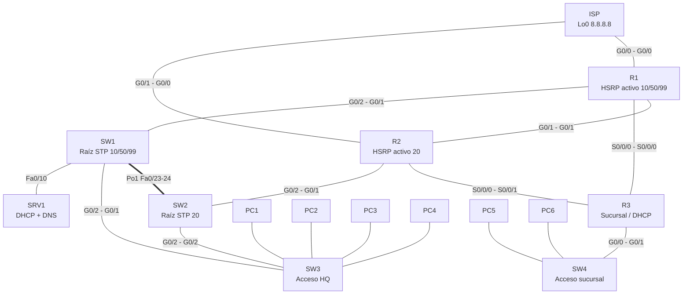

# Laboratorio integrador CCNA en Packet Tracer

Guía de estudio para practicar los temas de red empresarial del examen CCNA 200-301: VLANs, troncales, EtherChannel, STP, seguridad de puertos, HSRP, OSPF, rutas estáticas y flotantes, DHCP y DNS.

> **Cómo usar esta guía.** Abre `CCNA-Lab-INICIAL.pkt`, que trae la topología cableada y **sin ninguna configuración**. Cada sección te dice *qué* lograr y *por qué*; los comandos exactos los tienes que investigar tú (hay pistas). La configuración completa está en el Anexo A y `CCNA-Lab-SOLUCION.pkt` es el lab ya resuelto, para comparar al final.

---

## 1. Introducción

**Objetivo.** Construir desde cero la red de una empresa con una sede principal (HQ) redundante y una sucursal, salida a "Internet" con respaldo, y servicios DHCP y DNS.

**Temas del temario CCNA que cubre:**

| Dominio CCNA | Temas en este lab |
|---|---|
| Acceso a la red | VLANs, troncales 802.1Q, VLAN nativa, EtherChannel LACP, Rapid PVST+, seguridad de puertos |
| Conectividad IP | Router-on-a-stick, OSPFv2 de área única, rutas estáticas, ruta por defecto, ruta estática flotante |
| Servicios IP | DHCP en router y en servidor, relay (`ip helper-address`), DNS, HSRP |
| Seguridad | SSH v2, usuarios locales, `enable secret`, cifrado de contraseñas, banner, `bpduguard` |

**Tiempo estimado:** de 3 a 4 horas la primera vez; 1 hora y media si ya practicaste cada tema por separado.

---

## 2. Topología

### Diagrama



### Dispositivos

| Equipo | Modelo | Módulos | Rol |
|---|---|---|---|
| ISP | 2911 | — | Simula Internet (Loopback 8.8.8.8) |
| R1 | 2911 | HWIC-2T | Borde HQ, HSRP activo en VLAN 10/50/99 |
| R2 | 2911 | HWIC-2T | Borde HQ, HSRP activo en VLAN 20 |
| R3 | 2911 | HWIC-2T | Sucursal, servidor DHCP local |
| SW1, SW2 | 2960-24TT | — | Distribución HQ |
| SW3 | 2960-24TT | — | Acceso HQ (port-security) |
| SW4 | 2960-24TT | — | Acceso sucursal |
| SRV1 | Server-PT | — | DHCP y DNS de HQ |
| PC1–PC6 | PC-PT | — | Clientes DHCP |

### Cableado

| Origen | Puerto | Destino | Puerto | Cable |
|---|---|---|---|---|
| ISP | G0/0 | R1 | G0/0 | **Cruzado** (ver Anexo C, nota 1) |
| ISP | G0/1 | R2 | G0/0 | **Cruzado** (ver Anexo C, nota 1) |
| R1 | G0/1 | R2 | G0/1 | Cruzado |
| R1 | S0/0/0 (DCE) | R3 | S0/0/0 | Serial |
| R2 | S0/0/0 (DCE) | R3 | S0/0/1 | Serial |
| R1 | G0/2 | SW1 | G0/1 | Directo |
| R2 | G0/2 | SW2 | G0/1 | Directo |
| SW1 | Fa0/23, Fa0/24 | SW2 | Fa0/23, Fa0/24 | Cruzado (Po1) |
| SW1 | G0/2 | SW3 | G0/1 | Cruzado |
| SW2 | G0/2 | SW3 | G0/2 | Cruzado |
| SW1 | Fa0/10 | SRV1 | Fa0 | Directo |
| SW3 | Fa0/1, Fa0/2 | PC1, PC2 | Fa0 | Directo |
| SW3 | Fa0/11, Fa0/12 | PC3, PC4 | Fa0 | Directo |
| R3 | G0/0 | SW4 | G0/1 | Directo |
| SW4 | Fa0/1, Fa0/2 | PC5, PC6 | Fa0 | Directo |

### VLANs

| VLAN | Nombre | Red | Gateway virtual (HSRP) |
|---|---|---|---|
| 10 | VENTAS | 192.168.10.0/24 | 192.168.10.1 |
| 20 | TI | 192.168.20.0/24 | 192.168.20.1 |
| 50 | SERVIDORES | 192.168.50.0/24 | 192.168.50.1 |
| 99 | GESTION | 192.168.99.0/24 | 192.168.99.1 |
| 999 | ESTACIONAMIENTO | — | Puertos sin uso |
| 1000 | NATIVA | — | VLAN nativa de los troncales |
| 30 | SUCURSAL | 192.168.30.0/24 | 192.168.30.1 (R3 G0/0), solo en SW4 |

### Direccionamiento

| Equipo | Interfaz | IP / Máscara |
|---|---|---|
| ISP | G0/0 · G0/1 · Lo0 | 203.0.113.1/30 · 203.0.113.5/30 · 8.8.8.8/32 |
| R1 | G0/0 · G0/1 · S0/0/0 · Lo0 | 203.0.113.2/30 · 10.0.0.1/30 · 10.0.0.5/30 · 1.1.1.1/32 |
| R1 | G0/2.10 / .20 / .50 / .99 | 192.168.10.2 / 20.2 / 50.2 / 99.2 (/24) |
| R2 | G0/0 · G0/1 · S0/0/0 · Lo0 | 203.0.113.6/30 · 10.0.0.2/30 · 10.0.0.9/30 · 2.2.2.2/32 |
| R2 | G0/2.10 / .20 / .50 / .99 | 192.168.10.3 / 20.3 / 50.3 / 99.3 (/24) |
| R3 | S0/0/0 · S0/0/1 · G0/0 · Lo0 | 10.0.0.6/30 · 10.0.0.10/30 · 192.168.30.1/24 · 3.3.3.3/32 |
| SW1 · SW2 · SW3 | VLAN 99 | 192.168.99.11 · .12 · .13 (/24), GW 192.168.99.1 |
| SW4 | VLAN 30 | 192.168.30.2/24, GW 192.168.30.1 |
| SRV1 | Fa0 | 192.168.50.10/24, GW 192.168.50.1, DNS 192.168.50.10 |
| PC1–PC6 | Fa0 | DHCP (las IPs exactas pueden variar, ver Anexo C) |

---

## 3. Instrucciones iniciales

1. Abre `CCNA-Lab-INICIAL.pkt` en Packet Tracer 9.
2. Los equipos **no tienen ninguna configuración**. Las interfaces de los routers están apagadas (es el valor de fábrica).
3. Credenciales que vas a configurar (úsalas tal cual, para poder comparar con la solución):
   - Usuario local: `admin` / `Cisco123!` (privilegio 15)
   - `enable secret`: `Class123!`
   - Dominio: `ccna.lab`
4. **Orden sugerido:** (1) básico y SSH → (2) interfaces de router → (3) VLANs y troncales → (4) EtherChannel → (5) STP → (6) seguridad de puertos → (7) HSRP → (8) OSPF → (9) rutas estáticas → (10) DHCP y DNS.
5. Después de cada tema, **verifica antes de seguir**. Un error de VLANs que arrastres hasta HSRP es muy difícil de encontrar.
6. Usa `Fast Forward Time` después de cablear o cambiar STP, para no esperar los temporizadores.

---

## 4. Temas

### Tema 1. Configuración básica y SSH

**Concepto.** Antes de conectar un equipo a la red de producción se le pone un nombre, se protege el acceso privilegiado y se cambia Telnet (texto plano) por SSH (cifrado). SSH necesita un nombre de dominio y un par de llaves RSA para generar la clave del servidor; por eso `ip domain-name` va antes de generar las llaves. En una empresa real, esto es lo primero que revisa una auditoría.

**Tareas.**
- Ponle nombre a cada router y switch, apaga la resolución DNS de comandos mal escritos y agrega un banner de acceso autorizado.
- Protege el modo privilegiado con una contraseña cifrada y asegúrate de que las contraseñas no aparezcan legibles en la configuración.
- Crea un usuario local con privilegio máximo.
- Habilita SSH versión 2 con llaves de 1024 bits y deja las líneas vty aceptando solo SSH con autenticación local. La consola también debe pedir el usuario local.
- En los switches, crea la interfaz de gestión y su gateway por defecto (tabla de direccionamiento). Deja esto para después del tema 3, cuando exista la VLAN 99.

**Pistas.** `hostname`, `no ip domain-lookup`, `banner motd`, `enable secret`, `service password-encryption`, `username ... privilege ... secret`, `ip domain-name`, `crypto key generate rsa`, `ip ssh version 2`, `line vty 0 4`, `transport input ssh`, `login local`, `interface vlan`, `ip default-gateway`.

**Verificación.**

```
ISP#show ip ssh
SSH Enabled - version 2.0
Authentication timeout: 120 secs; Authentication retries: 3
```

Desde PC1 (Desktop > Command Prompt), una vez que tengas las VLANs y el ruteo:

```
C:\> ssh -l admin 192.168.99.11
Password:
Acceso autorizado solamente. Toda actividad es monitoreada.

SW1#show ip interface brief | include Vlan99
Vlan99                 192.168.99.11   YES manual up                    up
```

**Errores comunes.**
- Generar las llaves sin haber puesto antes el `hostname` y el `ip domain-name`: el nombre de la llave sale incorrecto o el comando se rechaza.
- Olvidar `login local` en las líneas vty: SSH no deja entrar aunque el usuario exista.
- En Packet Tracer, `crypto key generate rsa modulus 1024` en una sola línea es rechazado. Hay que escribir `crypto key generate rsa` y contestar `1024` cuando pregunte los bits (Anexo C, nota 2).

**Preguntas tipo examen.**

1. ¿Qué par de comandos son **obligatorios** antes de poder generar llaves RSA para SSH?
   a) `ip ssh version 2` y `transport input ssh`
   b) `hostname` e `ip domain-name`
   c) `enable secret` y `username`
   d) `login local` y `service password-encryption`

2. Un técnico configuró `transport input ssh` en las líneas vty, pero no puede entrar por SSH aunque el usuario existe. ¿Qué falta?
   a) `login local` en las líneas vty
   b) `no ip domain-lookup`
   c) `ip ssh version 1`
   d) `enable password`

---

### Tema 2. Interfaces de router y router-on-a-stick

**Concepto.** Un router solo tiene unas cuantas interfaces físicas, pero una empresa tiene muchas VLANs. Con *router-on-a-stick* se usa **un solo cable troncal** entre el router y el switch, y en el router se crea una **subinterfaz por VLAN**, cada una con su encapsulación 802.1Q y su dirección IP. Es la forma barata de enrutar entre VLANs cuando no hay un switch capa 3. La subinterfaz de la VLAN nativa se marca como tal y no lleva IP.

**Tareas.**
- Asigna las direcciones de la tabla a todas las interfaces de los routers, con descripción, y enciéndelas.
- En los extremos DCE de los enlaces seriales, configura la velocidad de reloj de 64000.
- En R1 y R2 crea las subinterfaces para las VLANs 10, 20, 50 y 99, y la subinterfaz de la VLAN nativa 1000. La interfaz física que las contiene debe estar encendida y **sin dirección IP**.
- Agrega las loopbacks que usarás como router ID.

**Pistas.** `interface g0/2.10`, `encapsulation dot1Q 10`, `encapsulation dot1Q 1000 native`, `clock rate`, `no shutdown`, `description`.

**Verificación.**

```
R1#show ip interface brief
GigabitEthernet0/0     203.0.113.2     YES manual up                    up
GigabitEthernet0/1     10.0.0.1        YES manual up                    up
GigabitEthernet0/2     unassigned      YES NVRAM  up                    up
GigabitEthernet0/2.10  192.168.10.2    YES manual up                    up
GigabitEthernet0/2.20  192.168.20.2    YES manual up                    up
GigabitEthernet0/2.50  192.168.50.2    YES manual up                    up
GigabitEthernet0/2.99  192.168.99.2    YES manual up                    up
GigabitEthernet0/2.1000unassigned      YES unset  up                    up
Serial0/0/0            10.0.0.5        YES manual up                    up
Loopback0              1.1.1.1         YES manual up                    up
```

Comprueba también conectividad directa: `ping 203.0.113.1` desde R1 y `ping 10.0.0.6` (R3 por el serial).

**Errores comunes.**
- Olvidar `no shutdown` en la **interfaz física** G0/2: todas las subinterfaces quedan caídas aunque ellas mismas no estén apagadas.
- Poner la IP en la física y en las subinterfaces a la vez.
- Poner `clock rate` en el extremo DTE: el comando se rechaza o el enlace no sube. En Packet Tracer el extremo DCE es el que tiene el icono de reloj en el cable.
- No usar la palabra `native` en la subinterfaz de la VLAN nativa: la VLAN nativa no coincidirá con el switch.

**Preguntas tipo examen.**

3. En una topología router-on-a-stick, las subinterfaces están correctas, pero ninguna sube. ¿Cuál es la causa más probable?
   a) Falta `ip routing`
   b) La interfaz física del router está en `shutdown`
   c) Falta `clock rate`
   d) El switch tiene STP activado

4. ¿Cuál es la función del parámetro `native` en `encapsulation dot1Q 1000 native`?
   a) Cifra las tramas de la VLAN 1000
   b) Hace que el tráfico de la VLAN 1000 viaje sin etiqueta
   c) Convierte la subinterfaz en capa 2
   d) Activa la VLAN 1000 en el switch

---

### Tema 3. VLANs, troncales y puertos de acceso

**Concepto.** Una VLAN divide un switch en redes de capa 2 independientes: Ventas no ve el tráfico de TI aunque estén en el mismo equipo. Los puertos de **acceso** pertenecen a una sola VLAN y se conectan a PCs; los **troncales** transportan varias VLANs entre switches y routers, etiquetando cada trama con 802.1Q. La **VLAN nativa** es la única que viaja sin etiqueta, y debe ser la misma en ambos extremos; se mueve a una VLAN sin uso (aquí, la 1000) por seguridad. Los puertos sin usar se apagan y se mandan a una VLAN "estacionamiento".

**Tareas.**
- Crea y nombra las VLANs 10, 20, 50, 99, 999 y 1000 en SW1, SW2 y SW3. En SW4, crea la VLAN 30 y la 999.
- Configura como troncales los enlaces de SW1 y SW2 hacia el router, y los enlaces SW1–SW3 y SW2–SW3, con VLAN nativa 1000, lista de VLANs permitidas explícita y sin negociación dinámica.
- Asigna los puertos de acceso de la tabla de cableado a su VLAN. En SW4, los puertos de PC y el que va a R3 van en la VLAN 30.
- Apaga todos los puertos sin uso y asígnalos a la VLAN 999.

**Pistas.** `vlan`, `name`, `switchport mode trunk`, `switchport trunk native vlan`, `switchport trunk allowed vlan`, `switchport nonegotiate`, `switchport mode access`, `switchport access vlan`, `interface range`.

**Verificación.**

```
SW3#show vlan brief
VLAN Name                             Status    Ports
---- -------------------------------- --------- -------------------------------
1    default                          active
10   VENTAS                           active    Fa0/1, Fa0/2
20   TI                               active    Fa0/11, Fa0/12
50   SERVIDORES                       active
99   GESTION                          active
999  ESTACIONAMIENTO                  active    Fa0/3, Fa0/4, Fa0/5, Fa0/6
                                                Fa0/7, Fa0/8, Fa0/9, Fa0/10
                                                Fa0/13, ... Fa0/24
1000 NATIVA                           active

SW3#show interfaces trunk
Port        Mode         Encapsulation  Status        Native vlan
Gig0/1      on           802.1q         trunking      1000
Gig0/2      on           802.1q         trunking      1000

Port        Vlans allowed on trunk
Gig0/1      10,20,50,99,1000
Gig0/2      10,20,50,99,1000
```

**Errores comunes.**
- **VLAN nativa distinta** en cada extremo del troncal: Packet Tracer y IOS avisan con mensajes de CDP, y el tráfico sin etiqueta se mezcla entre VLANs.
- Permitir en el troncal una VLAN que no existe en el switch del otro lado.
- Olvidar crear la VLAN antes de asignar el puerto: IOS la crea sola, pero sin nombre.
- El **2960 solo soporta 802.1Q**: no existe `switchport trunk encapsulation`. En un 3560 sí hay que ponerlo antes de `mode trunk`. Si copias configuración de un 3560 a un 2960, ese comando da error.

**Preguntas tipo examen.**

5. Un troncal entre dos switches muestra mensajes de "native VLAN mismatch". ¿Qué debes hacer?
   a) Cambiar el modo a `dynamic desirable`
   b) Configurar la misma VLAN nativa en ambos extremos
   c) Quitar la lista de VLANs permitidas
   d) Activar VTP

6. ¿Qué hace `switchport nonegotiate` en un troncal?
   a) Impide que el puerto envíe tramas DTP
   b) Desactiva el etiquetado 802.1Q
   c) Bloquea la VLAN nativa
   d) Pone el puerto en modo acceso

---

### Tema 4. EtherChannel (LACP)

**Concepto.** Si conectas dos switches con dos cables, STP bloquearía uno de ellos y desperdiciarías la mitad del ancho de banda. EtherChannel agrupa varios enlaces físicos en uno **lógico** (Port-channel) que STP ve como un solo puerto: se usa todo el ancho de banda y, si un cable falla, el canal sigue arriba. **LACP** (estándar IEEE 802.3ad) negocia el canal; un lado debe estar en `active` y el otro en `active` o `passive`. PAgP es la versión propietaria de Cisco.

**Tareas.**
- Une los dos enlaces Fa0/23 y Fa0/24 entre SW1 y SW2 en un EtherChannel LACP.
- Configura el Port-channel como troncal con los mismos parámetros que el resto de troncales (nativa, VLANs permitidas, sin negociación).
- Añade una descripción al Port-channel.

**Pistas.** `interface range`, `channel-group 1 mode active`, `interface port-channel 1`, `show etherchannel summary`.

**Verificación.**

```
SW1#show etherchannel summary
Group  Port-channel  Protocol    Ports
------+-------------+-----------+----------------------------------------------
1      Po1(SU)           LACP   Fa0/23(P) Fa0/24(P)

SW1#show interfaces trunk
Port        Mode         Encapsulation  Status        Native vlan
Po1         on           802.1q         trunking      1000
Gig0/1      on           802.1q         trunking      1000
Gig0/2      on           802.1q         trunking      1000
```

`SU` significa *Layer 2, in use*; `P` significa que el puerto está *en el port-channel*.

**Errores comunes.**
- Modos incompatibles: `passive` con `passive`, o `auto` con `auto` (PAgP), nunca forman canal. LACP con PAgP tampoco.
- Que los puertos miembro tengan configuraciones distintas (velocidad, dúplex, VLAN nativa): el canal queda `(s)` suspendido o no se forma.
- Configurar el troncal solo en los puertos físicos y no en la interfaz Port-channel.

**Preguntas tipo examen.**

7. ¿Qué combinación de modos **no** forma un EtherChannel?
   a) LACP active – LACP passive
   b) LACP active – LACP active
   c) LACP passive – LACP passive
   d) PAgP desirable – PAgP auto

8. En `show etherchannel summary`, un puerto marcado `(D)` indica que:
   a) Está en el canal y reenviando
   b) Está caído
   c) Está en modo stand-alone
   d) Fue suspendido por STP

---

### Tema 5. Spanning Tree (Rapid PVST+)

**Concepto.** Una red con enlaces redundantes en capa 2 formaría bucles de tramas que saturan la red en segundos. STP elige un **puente raíz** por VLAN, deja un solo camino activo hacia él desde cada switch y **bloquea** el resto. Con **Rapid PVST+** (una instancia por VLAN, convergencia en segundos) se puede balancear: SW1 es raíz de unas VLANs y SW2 de otras, de modo que los dos enlaces se usan. La raíz se alinea con HSRP: si R1 es el gateway activo de la VLAN 10, que SW1 sea su raíz evita que el tráfico dé vueltas innecesarias. **PortFast** pone un puerto de PC directamente en reenvío, y **BPDU Guard** lo apaga si llega un BPDU (alguien conectó un switch).

**Tareas.**
- Activa Rapid PVST+ en los cuatro switches.
- SW1 debe ser raíz de las VLANs 10, 50 y 99, y raíz de respaldo de la 20. SW2, al revés.
- En todos los puertos que van a hosts, activa PortFast y BPDU Guard.

**Pistas.** `spanning-tree mode rapid-pvst`, `spanning-tree vlan ... root primary|secondary`, `spanning-tree portfast`, `spanning-tree bpduguard enable`, `show spanning-tree vlan`.

**Verificación.**

```
SW1#show spanning-tree vlan 10
VLAN0010
  Spanning tree enabled protocol rstp
  Root ID    Priority    24586
             Address     0000.0CD4.81ED
             This bridge is the root
Interface        Role Sts Cost      Prio.Nbr Type
Gi0/1            Desg FWD 4         128.25   P2p
Gi0/2            Desg FWD 4         128.26   P2p
Po1              Desg FWD 12        128.27   P2p

SW1#show spanning-tree vlan 20
VLAN0020
  Spanning tree enabled protocol rstp
  Root ID    Priority    24596
             Address     0001.43E5.45C3          <- esta es la MAC de SW2
             Cost        8
             Port        26(GigabitEthernet0/2)
Interface        Role Sts Cost      Prio.Nbr Type
Gi0/1            Desg FWD 4         128.25   P2p
Gi0/2            Root FWD 4         128.26   P2p
Po1              Altn BLK 12        128.27   P2p
```

La prioridad **24586** = 24576 + 10 (el ID de VLAN). En la VLAN 20, SW1 deja **bloqueado** (`Altn BLK`) el Po1 porque llega a la raíz SW2 por el otro camino con menor costo.

**Errores comunes.**
- Olvidar que la prioridad real es *prioridad configurada + ID de VLAN* (extended system ID).
- Poner `root primary` en los dos switches para la misma VLAN: el último que lo escribe gana, pero si lo vuelves a ejecutar puede cambiar.
- Activar PortFast en un puerto troncal: IOS lo ignora, pero es una mala práctica.
- Esperar a que STP converja: usa Fast Forward en Packet Tracer.

**Preguntas tipo examen.**

9. ¿Cómo se calcula el Bridge ID de un switch en la VLAN 20 con prioridad configurada de 24576?
   a) 24576
   b) 24596
   c) 24556
   d) 28672

10. ¿Qué ocurre si un puerto con BPDU Guard recibe un BPDU?
    a) Pasa a modo bloqueo
    b) Se pone en `err-disabled`
    c) Se convierte en puerto raíz
    d) Se reinicia el proceso STP

---

### Tema 6. Seguridad de puertos

**Concepto.** Cualquiera con un cable podría conectar su laptop a un puerto de la oficina. *Port security* limita cuántas direcciones MAC puede tener un puerto y qué hacer cuando se rebasa el límite. Con **sticky**, el switch aprende la MAC del primer equipo y la graba en la configuración. Los modos de violación son tres: **shutdown** (el puerto pasa a `err-disabled`, el más seguro y el más molesto), **restrict** (descarta las tramas de la MAC intrusa, registra y cuenta violaciones, pero el puerto sigue arriba) y **protect** (descarta sin registrar).

**Tareas.**
- En SW3, limita Fa0/1 y Fa0/2 (VLAN 10) a una MAC con aprendizaje sticky y apagado del puerto ante violación.
- En Fa0/11 y Fa0/12 (VLAN 20), el mismo límite y aprendizaje, pero con el modo en que el puerto se mantiene activo. Los dos modos son a propósito, para compararlos.

**Pistas.** `switchport port-security`, `... maximum`, `... mac-address sticky`, `... violation`, `show port-security`.

**Verificación.**

```
SW3#show port-security
Secure Port MaxSecureAddr CurrentAddr SecurityViolation Security Action
               (Count)       (Count)        (Count)
--------------------------------------------------------------------
        Fa0/1        1          1                 0         Shutdown
        Fa0/2        1          1                 0         Shutdown
       Fa0/11        1          1                 0         Restrict
       Fa0/12        1          1                 0         Restrict

SW3#show port-security interface FastEthernet0/1
Port Security              : Enabled
Port Status                : Secure-up
Violation Mode             : Shutdown
Maximum MAC Addresses      : 1
Sticky MAC Addresses       : 1
Last Source Address:Vlan   : 0001.9628.358D:10
Security Violation Count   : 0
```

**Errores comunes.**
- Activar `port-security` sin `switchport mode access`: IOS lo rechaza en puertos dinámicos.
- Que la MAC sticky se aprenda solo si hay tráfico; antes de eso, `CurrentAddr` es 0.
- Mover una PC de puerto y olvidarse de limpiar la MAC sticky: la violación es inmediata.
- Un puerto en `err-disabled` requiere `shutdown` y `no shutdown` para volver (o `errdisable recovery`).

**Preguntas tipo examen.**

11. Un puerto con `violation restrict` detecta una segunda MAC. ¿Qué pasa?
    a) El puerto pasa a `err-disabled`
    b) Se descartan las tramas de la MAC no autorizada, se incrementa el contador y el puerto sigue activo
    c) Se descartan sin ningún registro
    d) La MAC nueva reemplaza a la anterior

12. ¿Qué ventaja tiene `mac-address sticky` sobre configurar la MAC a mano?
    a) Cifra la MAC
    b) Aprende dinámicamente la MAC y la guarda en la configuración
    c) Permite más de 1 MAC
    d) Evita el `err-disabled`

---

### Tema 7. HSRP (gateway redundante)

**Concepto.** Si el único router que sirve de gateway se cae, toda una VLAN pierde la salida. HSRP crea una **IP virtual** (que es el gateway que ven los hosts) compartida por dos routers: el de mayor prioridad es el **Active** y contesta por la IP virtual; el otro queda **Standby**. Si el Active deja de enviar *hellos*, el Standby toma su lugar sin que los hosts cambien nada. Con **preempt**, el router con mayor prioridad recupera el rol cuando regresa. Aquí se reparte la carga: R1 es Active en tres VLANs y R2 en una.

**Tareas.**
- Configura HSRP versión 2 en las subinterfaces de R1 y R2, con el número de grupo igual al ID de la VLAN y la IP virtual `.1` de cada VLAN.
- R1 debe ganar en las VLANs 10, 50 y 99, y R2 en la VLAN 20. Quien gana lleva prioridad 110 y `preempt`; el otro, la prioridad por defecto.
- En las subinterfaces de las VLANs 10 y 20, de ambos routers, configura el reenvío de las peticiones DHCP hacia SRV1.

**Pistas.** `standby version 2`, `standby <grupo> ip`, `standby <grupo> priority`, `standby <grupo> preempt`, `ip helper-address`, `show standby brief`.

**Verificación.**

```
R1#show standby brief
Interface   Grp  Pri P State    Active          Standby         Virtual IP
Gig         10   110 P Active   local           192.168.10.3    192.168.10.1
Gig         20   100   Standby  192.168.20.3    local           192.168.20.1
Gig         50   110 P Active   local           192.168.50.3    192.168.50.1
Gig         99   110 P Active   local           192.168.99.3    192.168.99.1

R2#show standby brief
Gig         10   100   Standby  192.168.10.2    local           192.168.10.1
Gig         20   110 P Active   local           192.168.20.2    192.168.20.1
Gig         50   100   Standby  192.168.50.2    local           192.168.50.1
Gig         99   100   Standby  192.168.99.2    local           192.168.99.1
```

**Errores comunes.**
- **Sin `preempt`**, el router con mayor prioridad no recupera el rol Active al regresar.
- Versiones distintas (1 y 2) en cada router: no se ven. Con la versión 2 el grupo puede ser mayor a 255.
- Que la IP virtual sea la IP real de uno de los routers.
- **Olvidar `ip helper-address`**: los clientes DHCP de la VLAN no reciben dirección, porque el broadcast `DHCPDISCOVER` no cruza el router.
- Estados `Listen` o `Speak` inmediatamente después de configurar: es normal unos segundos. Si persisten, revisa la conectividad de capa 2 entre R1 y R2 (Anexo C, nota 5).

**Preguntas tipo examen.**

13. R1 tiene prioridad 110 y R2 100, ambos sin `preempt`. R1 se reinicia y R2 toma el rol Active. Cuando R1 regresa, ¿quién es Active?
    a) R1, porque tiene mayor prioridad
    b) R2, porque R1 no tiene `preempt` y R2 ya es Active
    c) Ninguno
    d) Los dos

14. ¿Qué dirección usan los hosts como gateway en un grupo HSRP?
    a) La IP del router Active
    b) La IP del router Standby
    c) La IP virtual del grupo
    d) La IP de broadcast

---

### Tema 8. OSPF de área única

**Concepto.** OSPF es un protocolo de estado de enlace: cada router aprende la topología completa y calcula con Dijkstra el mejor camino. Los routers primero forman **vecindades**, intercambian LSAs y llegan a `FULL`. El **costo** de cada enlace se calcula con ancho de banda de referencia / ancho de banda de la interfaz; el valor por defecto (100 Mbps) hace que Gigabit y Fast Ethernet cuesten lo mismo, por eso se sube a 1000. Las interfaces hacia LANs se marcan **pasivas**: se anuncian pero no mandan hellos hacia los usuarios. En enlaces punto a punto no hay elección de DR/BDR.

**Tareas.**
- Habilita OSPF proceso 10 en R1, R2 y R3, con el router ID igual a la loopback, y ajusta el ancho de banda de referencia a 1000.
- Anuncia en el área 0 los enlaces 10.0.0.x, las LANs de cada router y las loopbacks, usando wildcards.
- Marca como pasivas las subinterfaces LAN de R1 y R2 y la G0/0 de R3.
- Declara el enlace R1–R2 como punto a punto.
- R1 y R2 deben anunciar su ruta por defecto al resto del dominio.

**Pistas.** `router ospf 10`, `router-id`, `auto-cost reference-bandwidth`, `network ... area 0`, `passive-interface`, `ip ospf network point-to-point`, `default-information originate`, `show ip ospf neighbor`.

**Verificación.**

```
R1#show ip ospf neighbor
Neighbor ID     Pri   State           Dead Time   Address         Interface
2.2.2.2           0   FULL/  -        00:00:38    10.0.0.2        GigabitEthernet0/1
3.3.3.3           0   FULL/  -        00:00:39    10.0.0.6        Serial0/0/0

R3#show ip route ospf
O       1.1.1.1 [110/647] via 10.0.0.5, 00:00:26, Serial0/0/0
O       2.2.2.2 [110/647] via 10.0.0.9, 00:00:26, Serial0/0/1
O    192.168.10.0 [110/657] via 10.0.0.5, Serial0/0/0
                  [110/657] via 10.0.0.9, Serial0/0/1
...
O*E2 0.0.0.0/0 [110/1] via 10.0.0.5, 00:00:26, Serial0/0/0
O*E2 0.0.0.0/0 [110/1] via 10.0.0.9, 00:00:26, Serial0/0/1
```

Los costos 647 y 657 vienen de la velocidad de los seriales (1544 kbps) con la referencia en 1000 Mbps. R3 ve **dos** caminos de igual costo hacia la LAN de HQ.

```
R1#show ip protocols
Routing Protocol is "ospf 10"
  Router ID 1.1.1.1
  It is an autonomous system boundary router
  Routing for Networks:
    10.0.0.0 0.0.0.3 area 0
    ...
  Passive Interface(s):
    GigabitEthernet0/2.10  GigabitEthernet0/2.20
    GigabitEthernet0/2.50  GigabitEthernet0/2.99
```

**Errores comunes.**
- Cambiar `reference-bandwidth` en un router y no en todos: los costos dejan de ser comparables y se eligen caminos inesperados.
- Un wildcard mal calculado (`0.0.0.3` para /30, `0.0.0.255` para /24, `0.0.0.0` para un host).
- Que los temporizadores hello/dead o el tipo de red no coincidan: los vecinos se quedan en `INIT` o `EXSTART`.
- Marcar como pasiva una interfaz que sí debe formar vecindad.
- `default-information originate` sin tener una ruta por defecto en la tabla (ver Anexo C, nota 6).

**Preguntas tipo examen.**

15. ¿Qué wildcard corresponde a la red 10.0.0.4/30?
    a) 0.0.0.255
    b) 0.0.0.3
    c) 0.0.0.7
    d) 0.0.0.15

16. ¿Para qué sirve `passive-interface` en OSPF?
    a) Impide anunciar la red de esa interfaz
    b) Impide enviar y recibir hellos, pero la red sigue anunciándose
    c) Apaga la interfaz
    d) Cambia el costo de la interfaz

17. R1 es ASBR con una ruta estática por defecto. ¿Qué comando propaga esa ruta a los demás routers OSPF?
    a) `redistribute connected`
    b) `default-information originate`
    c) `network 0.0.0.0 0.0.0.0 area 0`
    d) `ip route 0.0.0.0 0.0.0.0 null0`

---

### Tema 9. Rutas estáticas y ruta flotante

**Concepto.** Una **ruta estática** la escribe el administrador y tiene distancia administrativa (AD) 1; OSPF tiene 110. Cuando hay dos rutas al mismo destino, gana la de **menor AD**. Una **ruta flotante** es una estática con una AD deliberadamente alta (mayor que la del protocolo dinámico), de modo que "flota" sin instalarse mientras la ruta principal exista y solo entra cuando esta desaparece. Es la forma clásica de tener un enlace de respaldo sin protocolo de ruteo hacia el ISP.

**Tareas.**
- R1: ruta por defecto hacia el ISP (principal).
- R2: ruta por defecto hacia el ISP como flotante, con una AD mayor a la de OSPF.
- ISP: ruta hacia todo el espacio `192.168.0.0/16` por R1 (principal, AD 1) y por R2 (flotante, con una AD mayor a 1; el ISP no corre ningún protocolo dinámico, así que basta con que sea más alta que la principal).

**Pistas.** `ip route`, el último parámetro es la distancia administrativa, `show ip route static`, `show ip route 0.0.0.0`.

**Verificación.**

```
R1#show ip route static
S*   0.0.0.0/0 [1/0] via 203.0.113.1

R2#show ip route 0.0.0.0
Routing entry for 0.0.0.0/0, supernet
Known via "ospf 10", distance 110, metric 1, candidate default path
  Tag 1, type extern 2, forward metric 1
  * 10.0.0.1, from 1.1.1.1, via GigabitEthernet0/1

R2#show ip route static
(sin salida: la flotante no está instalada)

ISP#show ip route static
S    192.168.0.0/16 [1/0] via 203.0.113.2
```

La de R2 **no aparece** en la tabla, y la de ISP hacia `203.0.113.6` tampoco: están "flotando". Se verán en la prueba de falla 1.

**Errores comunes.**
- Poner una AD flotante **menor** que la del protocolo dinámico (por ejemplo 100 contra OSPF 110): la estática gana siempre y deja de ser respaldo.
- Pensar que la flotante aparece en `show ip route`: solo aparece en `show running-config` hasta que entra.
- Ruta estática con interfaz de salida en vez de siguiente salto en una interfaz Ethernet: genera ARP por cada destino.

**Preguntas tipo examen.**

18. Un router tiene `ip route 0.0.0.0 0.0.0.0 203.0.113.5 200` y aprende una ruta por defecto por OSPF. ¿Cuál se instala?
    a) La estática, porque se configuró a mano
    b) La de OSPF (AD 110)
    c) Ambas
    d) Ninguna

19. ¿Cuál es la distancia administrativa por defecto de una ruta estática?
    a) 0
    b) 1
    c) 90
    d) 110

---

### Tema 10. DHCP y DNS

**Concepto.** DHCP entrega a los clientes IP, máscara, gateway y DNS automáticamente. El cliente manda un broadcast (`DISCOVER`) que **no cruza routers**; por eso, si el servidor está en otra VLAN, el router de la VLAN del cliente lo reenvía como unicast con el **relay** (`ip helper-address`). En la sucursal el propio router R3 es servidor DHCP. DNS traduce nombres a direcciones IP; aquí SRV1 resuelve `www.ccna.lab` y `srv1.ccna.lab`.

**Tareas.**
- Configura SRV1 con IP fija y crea en su servicio DHCP los pools de las VLANs 10 y 20 (gateway virtual, DNS = SRV1, inicio en `.11`, 100 usuarios).
- Agrega en su servicio DNS los registros `www.ccna.lab → 8.8.8.8` y `srv1.ccna.lab → 192.168.50.10`.
- Configura en R3 un pool DHCP para la sucursal, excluyendo las 10 primeras direcciones, con gateway, DNS y nombre de dominio.
- Pon las seis PCs en modo DHCP.

**Pistas.** Server-PT > Services > DHCP/DNS; en el router `ip dhcp excluded-address`, `ip dhcp pool`, `network`, `default-router`, `dns-server`, `domain-name`, `show ip dhcp pool`, `ipconfig /all`, `nslookup`.

**Pasos manuales en Server-PT (clic por clic).** Si prefieres hacerlo por la interfaz gráfica:
1. Haz clic en **SRV1** > pestaña **Desktop** > **IP Configuration**. Selecciona **Static** y escribe IP `192.168.50.10`, máscara `255.255.255.0`, gateway `192.168.50.1`, DNS `192.168.50.10`.
2. Pestaña **Services** > **DHCP**. Pon el servicio en **On**.
3. Escribe en *Pool Name* `VLAN10`, *Default Gateway* `192.168.10.1`, *DNS Server* `192.168.50.10`, *Start IP* `192.168.10.11`, *Subnet Mask* `255.255.255.0`, *Maximum Number of Users* `100`. Pulsa **Add**.
4. Repite con `VLAN20` y la red 192.168.20.0.
5. Selecciona el pool `serverPool` de fábrica y pulsa **Remove** (si no, entrega direcciones de la red del servidor).
6. Pestaña **Services** > **DNS**. Pon el servicio en **On**. Agrega: *Name* `www.ccna.lab`, *Type* `A Record`, *Address* `8.8.8.8` > **Add**; *Name* `srv1.ccna.lab`, *Address* `192.168.50.10` > **Add**.
7. En cada PC: **Desktop** > **IP Configuration** > **DHCP**.

**Verificación.**

```
R3#show ip dhcp pool                          (justo después de crear el pool, antes de que las PCs pidieran IP)
Pool SUCURSAL :
 Total addresses                : 254
 Leased addresses               : 0
 Excluded addresses             : 1
 ...
 192.168.30.1         192.168.30.1     - 192.168.30.254

C:\> ipconfig                                 (PC1, después de ipconfig /renew)
   IPv4 Address....................: 192.168.10.14
   Subnet Mask.....................: 255.255.255.0
   Default Gateway.................: 192.168.10.1
   DNS Server......................: 192.168.50.10

C:\> nslookup srv1.ccna.lab                   (PC3)
Server: [192.168.50.10]
Name:   srv1.ccna.lab
Address:   192.168.50.10

C:\> ping www.ccna.lab                        (PC3)
Pinging 8.8.8.8 with 32 bytes of data:
Reply from 8.8.8.8: bytes=32 time<1ms TTL=254
```

Conectividad extremo a extremo que debes comprobar:

```
PC1 -> PC3 (entre VLANs):    ping 192.168.20.12  -> responde
PC1 -> PC5 (entre sitios):   ping 192.168.30.11  -> responde, TTL=126
PC5 -> 8.8.8.8:              0% de pérdida, TTL=253
```

**Errores comunes.**
- Sin `ip helper-address`, las PCs de HQ se quedan con una dirección `169.254.x.x` (APIPA).
- Pool del servidor con el gateway dentro del rango repartible: el servidor podría entregar la IP del gateway. Por eso el inicio es `.11`.
- Que el servidor DHCP no tenga IP en una red alcanzable desde los routers.
- En R3, olvidar excluir las direcciones del gateway y de SW4 antes de crear el pool.
- Si lanzas las seis solicitudes a la vez, alguna PC puede quedarse en APIPA: reintenta con `ipconfig /renew`.

**Preguntas tipo examen.**

20. Los clientes de la VLAN 10 no reciben IP; el servidor DHCP está en la VLAN 50. ¿Qué falta?
    a) `ip helper-address` en la subinterfaz de la VLAN 10
    b) `ip dhcp pool` en el switch
    c) `ip routing`
    d) Un segundo pool en la VLAN 50

21. ¿Qué dirección IP recibe una PC cuando no encuentra servidor DHCP?
    a) 0.0.0.0
    b) 169.254.x.x
    c) 192.168.0.1
    d) 255.255.255.255

---

## 5. Pruebas de falla

Cada prueba es un reto: **antes de ejecutarla, escribe qué esperas que pase.** Al final de cada una restaura el estado original y confirma que todo vuelve a la normalidad.

### Prueba 1. Cae el enlace principal a Internet (R1 G0/0)

**Acción:** `shutdown` en R1 G0/0.

**¿Qué esperas?** Piensa: ¿qué ruta por defecto pierde R1? ¿Qué pasa con la flotante de R2? ¿Por dónde vuelve el tráfico desde el ISP?

<details><summary>Ver resultado</summary>

Antes (estado normal):
```
R2#show ip route 0.0.0.0   -> Known via "ospf 10", distance 110  (via R1)
R3#show ip route 0.0.0.0   -> O*E2 por R1 y por R2
ISP#show ip route static   -> S 192.168.0.0/16 [1/0] via 203.0.113.2
```

Después de apagar R1 G0/0:
```
R2#show ip route 0.0.0.0
Known via "static", distance 200, metric 0, candidate default path
  * 203.0.113.5

R3#show ip route 0.0.0.0
Known via "ospf 10", distance 110, metric 1
  * 10.0.0.9, from 2.2.2.2, via Serial0/0/1          <- ahora solo por R2

ISP#show ip route static
S    192.168.0.0/16 [10/0] via 203.0.113.6           <- la flotante del ISP entró
```
`PC1 -> 8.8.8.8` y `PC5 -> 8.8.8.8`: 0% de pérdida (TTL 253/254 por el camino de R2).

**Nota importante (Anexo C, nota 6):** en Packet Tracer, R3 **no** recibía la default de R2 hasta que se escribió de nuevo `no default-information originate` y `default-information originate` en R2.

Al restaurar con `no shutdown`: R1 vuelve a la estática con AD 1, R2 vuelve a la OSPF (110) y el ISP regresa a `[1/0] via 203.0.113.2`.
</details>

### Prueba 2. Cae R1 hacia los switches (R1 G0/2)

**Acción:** `shutdown` en R1 G0/2.

**¿Qué esperas?** ¿Quién queda Active en cada VLAN? ¿Qué pasa con la VLAN 20? ¿Qué ocurre al restaurar?

<details><summary>Ver resultado</summary>

```
R2#show standby brief
Gig         10   100   Active   local           unknown         192.168.10.1
Gig         20   110 P Active   local           192.168.20.2    192.168.20.1
Gig         50   100   Active   local           unknown         192.168.50.1
Gig         99   100   Active   local           unknown         192.168.99.1
```
R2 toma las cuatro VLANs. `PC1 -> 8.8.8.8`: 25% de pérdida (se pierde un paquete mientras conmuta), después responde.

Al restaurar con `no shutdown`, R1 recupera 10, 50 y 99 **por `preempt`**:
```
R1#show standby brief
Gig         10   110 P Active   local           192.168.10.3    192.168.10.1
Gig         20   100   Standby  192.168.20.3    local           192.168.20.1
Gig         50   110 P Active   local           192.168.50.3    192.168.50.1
Gig         99   110 P Active   local           192.168.99.3    192.168.99.1
```
En la VLAN 20 nada cambia: R2 ya era Active y R1 nunca lo disputó (no tiene `preempt` ahí).
</details>

### Prueba 3. Cae un puerto del EtherChannel (SW1 Fa0/23)

**Acción:** `shutdown` en SW1 Fa0/23.

**¿Qué esperas?** ¿Se cae el canal? ¿Se pierde conectividad entre SW1 y SW2?

<details><summary>Ver resultado</summary>

```
SW1#show etherchannel summary
1      Po1(SU)           LACP   Fa0/23(D) Fa0/24(P)

SW1#ping 192.168.99.12
Success rate is 60 percent (3/5)          <- los primeros paquetes se pierden por ARP
```
El canal sigue `(SU)` con un solo miembro activo (`Fa0/24(P)`), pero con la mitad del ancho de banda. Al hacer `no shutdown`, vuelve a `Fa0/23(P) Fa0/24(P)`.
</details>

---

## 6. Retos extra (opcionales, sin solución)

1. Cambia el costo OSPF para que R3 **prefiera R1** sobre R2 para llegar a HQ. ¿Qué comando usas y en qué interfaz?
2. Provoca una **violación de port-security** conectando otra PC en Fa0/1 de SW3 y otra en Fa0/11. Compara qué pasa con cada modo y cómo recuperas el puerto.
3. Agrega una **ACL** que bloquee SSH desde la VLAN 20 hacia la red de gestión (VLAN 99), sin afectar el resto del tráfico. ¿En qué interfaz y en qué dirección la aplicas?
4. Haz que R2 sea el Active de la VLAN 99 sin cambiar prioridades (pista: *tracking*).
5. Sustituye la ruta por defecto estática de R1 por una aprendida por OSPF del ISP.
6. Cambia el EtherChannel de LACP a PAgP sin perder conectividad.

---

## Anexo A. Configuraciones completas

> Estas son las líneas aplicadas, agrupadas por equipo. Las contraseñas aparecen tal como las debes escribir; en `show running-config` verás los hashes por `service password-encryption`.

### Común a los 8 equipos de red

```
hostname <NOMBRE>
no ip domain-lookup
service password-encryption
enable secret Class123!
username admin privilege 15 secret Cisco123!
ip domain-name ccna.lab
crypto key generate rsa            ! contestar 1024 cuando pregunte
ip ssh version 2
banner motd #Acceso autorizado solamente. Toda actividad es monitoreada.#
line console 0
 login local
line vty 0 4
 transport input ssh
 login local
```

### ISP

```
interface GigabitEthernet0/0
 description Enlace a R1 G0/0 (principal)
 ip address 203.0.113.1 255.255.255.252
 no shutdown
interface GigabitEthernet0/1
 description Enlace a R2 G0/0 (respaldo)
 ip address 203.0.113.5 255.255.255.252
 no shutdown
interface Loopback0
 description Simula Internet
 ip address 8.8.8.8 255.255.255.255
ip route 192.168.0.0 255.255.0.0 203.0.113.2
ip route 192.168.0.0 255.255.0.0 203.0.113.6 10
```

### R1

```
interface GigabitEthernet0/0
 description Enlace principal a ISP
 ip address 203.0.113.2 255.255.255.252
 no shutdown
interface GigabitEthernet0/1
 description Enlace a R2 G0/1
 ip address 10.0.0.1 255.255.255.252
 ip ospf network point-to-point
 no shutdown
interface Serial0/0/0
 description Enlace serial a R3 S0/0/0 (DCE)
 ip address 10.0.0.5 255.255.255.252
 clock rate 64000
 no shutdown
interface GigabitEthernet0/2
 description Trunk a SW1 G0/1 (router-on-a-stick)
 no ip address
 no shutdown
interface GigabitEthernet0/2.10
 description VLAN 10 VENTAS
 encapsulation dot1Q 10
 ip address 192.168.10.2 255.255.255.0
 ip helper-address 192.168.50.10
 standby version 2
 standby 10 ip 192.168.10.1
 standby 10 priority 110
 standby 10 preempt
interface GigabitEthernet0/2.20
 description VLAN 20 TI
 encapsulation dot1Q 20
 ip address 192.168.20.2 255.255.255.0
 ip helper-address 192.168.50.10
 standby version 2
 standby 20 ip 192.168.20.1
 standby 20 priority 100
interface GigabitEthernet0/2.50
 description VLAN 50 SERVIDORES
 encapsulation dot1Q 50
 ip address 192.168.50.2 255.255.255.0
 standby version 2
 standby 50 ip 192.168.50.1
 standby 50 priority 110
 standby 50 preempt
interface GigabitEthernet0/2.99
 description VLAN 99 GESTION
 encapsulation dot1Q 99
 ip address 192.168.99.2 255.255.255.0
 standby version 2
 standby 99 ip 192.168.99.1
 standby 99 priority 110
 standby 99 preempt
interface GigabitEthernet0/2.1000
 description VLAN 1000 NATIVA
 encapsulation dot1Q 1000 native
interface Loopback0
 description Router ID OSPF
 ip address 1.1.1.1 255.255.255.255
router ospf 10
 router-id 1.1.1.1
 auto-cost reference-bandwidth 1000
 network 10.0.0.0 0.0.0.3 area 0
 network 10.0.0.4 0.0.0.3 area 0
 network 192.168.10.0 0.0.0.255 area 0
 network 192.168.20.0 0.0.0.255 area 0
 network 192.168.50.0 0.0.0.255 area 0
 network 192.168.99.0 0.0.0.255 area 0
 network 1.1.1.1 0.0.0.0 area 0
 passive-interface GigabitEthernet0/2.10
 passive-interface GigabitEthernet0/2.20
 passive-interface GigabitEthernet0/2.50
 passive-interface GigabitEthernet0/2.99
 default-information originate
ip route 0.0.0.0 0.0.0.0 203.0.113.1
```

### R2

```
interface GigabitEthernet0/0
 description Enlace de respaldo a ISP
 ip address 203.0.113.6 255.255.255.252
 no shutdown
interface GigabitEthernet0/1
 description Enlace a R1 G0/1
 ip address 10.0.0.2 255.255.255.252
 ip ospf network point-to-point
 no shutdown
interface Serial0/0/0
 description Enlace serial a R3 S0/0/1 (DCE)
 ip address 10.0.0.9 255.255.255.252
 clock rate 64000
 no shutdown
interface GigabitEthernet0/2
 description Trunk a SW2 G0/1 (router-on-a-stick)
 no ip address
 no shutdown
interface GigabitEthernet0/2.10
 description VLAN 10 VENTAS
 encapsulation dot1Q 10
 ip address 192.168.10.3 255.255.255.0
 ip helper-address 192.168.50.10
 standby version 2
 standby 10 ip 192.168.10.1
 standby 10 priority 100
interface GigabitEthernet0/2.20
 description VLAN 20 TI
 encapsulation dot1Q 20
 ip address 192.168.20.3 255.255.255.0
 ip helper-address 192.168.50.10
 standby version 2
 standby 20 ip 192.168.20.1
 standby 20 priority 110
 standby 20 preempt
interface GigabitEthernet0/2.50
 description VLAN 50 SERVIDORES
 encapsulation dot1Q 50
 ip address 192.168.50.3 255.255.255.0
 standby version 2
 standby 50 ip 192.168.50.1
 standby 50 priority 100
interface GigabitEthernet0/2.99
 description VLAN 99 GESTION
 encapsulation dot1Q 99
 ip address 192.168.99.3 255.255.255.0
 standby version 2
 standby 99 ip 192.168.99.1
 standby 99 priority 100
interface GigabitEthernet0/2.1000
 description VLAN 1000 NATIVA
 encapsulation dot1Q 1000 native
interface Loopback0
 description Router ID OSPF
 ip address 2.2.2.2 255.255.255.255
router ospf 10
 router-id 2.2.2.2
 auto-cost reference-bandwidth 1000
 network 10.0.0.0 0.0.0.3 area 0
 network 10.0.0.8 0.0.0.3 area 0
 network 192.168.10.0 0.0.0.255 area 0
 network 192.168.20.0 0.0.0.255 area 0
 network 192.168.50.0 0.0.0.255 area 0
 network 192.168.99.0 0.0.0.255 area 0
 network 2.2.2.2 0.0.0.0 area 0
 passive-interface GigabitEthernet0/2.10
 passive-interface GigabitEthernet0/2.20
 passive-interface GigabitEthernet0/2.50
 passive-interface GigabitEthernet0/2.99
 default-information originate
ip route 0.0.0.0 0.0.0.0 203.0.113.5 200
```

### R3

```
interface Serial0/0/0
 description Enlace serial a R1 S0/0/0
 ip address 10.0.0.6 255.255.255.252
 no shutdown
interface Serial0/0/1
 description Enlace serial a R2 S0/0/0
 ip address 10.0.0.10 255.255.255.252
 no shutdown
interface GigabitEthernet0/0
 description LAN sucursal VLAN 30 hacia SW4
 ip address 192.168.30.1 255.255.255.0
 no shutdown
interface Loopback0
 description Router ID OSPF
 ip address 3.3.3.3 255.255.255.255
router ospf 10
 router-id 3.3.3.3
 auto-cost reference-bandwidth 1000
 network 10.0.0.4 0.0.0.3 area 0
 network 10.0.0.8 0.0.0.3 area 0
 network 192.168.30.0 0.0.0.255 area 0
 network 3.3.3.3 0.0.0.0 area 0
 passive-interface GigabitEthernet0/0
ip dhcp excluded-address 192.168.30.1 192.168.30.10
ip dhcp pool SUCURSAL
 network 192.168.30.0 255.255.255.0
 default-router 192.168.30.1
 dns-server 192.168.50.10
 domain-name ccna.lab
```

### SW1

```
vlan 10
 name VENTAS
vlan 20
 name TI
vlan 50
 name SERVIDORES
vlan 99
 name GESTION
vlan 999
 name ESTACIONAMIENTO
vlan 1000
 name NATIVA
spanning-tree mode rapid-pvst
spanning-tree vlan 10,50,99 root primary
spanning-tree vlan 20 root secondary
interface range GigabitEthernet0/1 - 2
 switchport mode trunk
 switchport trunk native vlan 1000
 switchport trunk allowed vlan 10,20,50,99,1000
 switchport nonegotiate
interface GigabitEthernet0/1
 description Trunk a R1 G0/2
interface GigabitEthernet0/2
 description Trunk a SW3 G0/1
interface range FastEthernet0/23 - 24
 channel-group 1 mode active
interface Port-channel1
 description EtherChannel LACP a SW2
 switchport mode trunk
 switchport trunk native vlan 1000
 switchport trunk allowed vlan 10,20,50,99,1000
 switchport nonegotiate
 spanning-tree link-type point-to-point
interface FastEthernet0/10
 description SRV1
 switchport mode access
 switchport access vlan 50
 spanning-tree portfast
 spanning-tree bpduguard enable
interface range FastEthernet0/1 - 9 , FastEthernet0/11 - 22
 switchport mode access
 switchport access vlan 999
 shutdown
interface Vlan99
 description SVI de gestion
 ip address 192.168.99.11 255.255.255.0
 no shutdown
ip default-gateway 192.168.99.1
```

### SW2

```
(VLANs, troncales GigabitEthernet0/1-2 y Port-channel1 idénticos a SW1; descripciones: G0/1 "Trunk a R2 G0/2", G0/2 "Trunk a SW3 G0/2")
spanning-tree mode rapid-pvst
spanning-tree vlan 20 root primary
spanning-tree vlan 10,50,99 root secondary
interface range FastEthernet0/23 - 24
 channel-group 1 mode active
interface Port-channel1
 spanning-tree link-type point-to-point
interface range FastEthernet0/1 - 22
 switchport mode access
 switchport access vlan 999
 shutdown
interface Vlan99
 ip address 192.168.99.12 255.255.255.0
 no shutdown
ip default-gateway 192.168.99.1
```

### SW3

```
(VLANs idénticas a SW1; troncales GigabitEthernet0/1-2 con los mismos parámetros)
spanning-tree mode rapid-pvst
interface range FastEthernet0/1 - 2
 switchport mode access
 switchport access vlan 10
 switchport port-security
 switchport port-security maximum 1
 switchport port-security violation shutdown
 switchport port-security mac-address sticky
 spanning-tree portfast
 spanning-tree bpduguard enable
interface range FastEthernet0/11 - 12
 switchport mode access
 switchport access vlan 20
 switchport port-security
 switchport port-security maximum 1
 switchport port-security violation restrict
 switchport port-security mac-address sticky
 spanning-tree portfast
 spanning-tree bpduguard enable
interface range FastEthernet0/3 - 10 , FastEthernet0/13 - 24
 switchport mode access
 switchport access vlan 999
 shutdown
interface Vlan99
 ip address 192.168.99.13 255.255.255.0
 no shutdown
ip default-gateway 192.168.99.1
```

### SW4

```
vlan 30
 name SUCURSAL
vlan 999
 name ESTACIONAMIENTO
spanning-tree mode rapid-pvst
interface range FastEthernet0/1 - 2 , GigabitEthernet0/1
 switchport mode access
 switchport access vlan 30
interface range FastEthernet0/1 - 2
 spanning-tree portfast
 spanning-tree bpduguard enable
interface range FastEthernet0/3 - 24 , GigabitEthernet0/2
 switchport mode access
 switchport access vlan 999
 shutdown
interface Vlan30
 ip address 192.168.30.2 255.255.255.0
 no shutdown
ip default-gateway 192.168.30.1
```

### SRV1 (Server-PT, por interfaz gráfica)

| Servicio | Configuración |
|---|---|
| IP | 192.168.50.10/24, gateway 192.168.50.1, DNS 192.168.50.10 |
| DHCP | Pool `VLAN10`: 192.168.10.0/24, gw 192.168.10.1, DNS 192.168.50.10, inicio 192.168.10.11, 100 usuarios |
| DHCP | Pool `VLAN20`: 192.168.20.0/24, gw 192.168.20.1, DNS 192.168.50.10, inicio 192.168.20.11, 100 usuarios |
| DHCP | `serverPool` de fábrica eliminado |
| DNS | `www.ccna.lab` A `8.8.8.8` · `srv1.ccna.lab` A `192.168.50.10` |

---

## Anexo B. Respuestas

| # | Resp. | Explicación |
|---|---|---|
| 1 | **b** | SSH necesita un nombre de host y un dominio para formar el nombre de la llave RSA (`R1.ccna.lab`). |
| 2 | **a** | `transport input ssh` solo limita el protocolo. Sin `login local` las vty no autentican contra el usuario local. |
| 3 | **b** | Con la interfaz física apagada, las subinterfaces heredan el estado caído. |
| 4 | **b** | `native` hace que esa VLAN viaje sin etiqueta 802.1Q, igual que la VLAN nativa del troncal en el switch. |
| 5 | **b** | La VLAN nativa debe coincidir en ambos extremos. |
| 6 | **a** | Desactiva DTP: el puerto no negocia ni anuncia el modo troncal. |
| 7 | **c** | `passive`–`passive` nunca inicia la negociación. Las otras tres combinaciones sí forman canal. |
| 8 | **b** | `D` = down. |
| 9 | **b** | Bridge ID = prioridad configurada + ID de VLAN: 24576 + 20 = 24596. |
| 10 | **b** | BPDU Guard pone el puerto en `err-disabled`. |
| 11 | **b** | `restrict` descarta las tramas no autorizadas, registra y cuenta la violación, pero deja el puerto activo. |
| 12 | **b** | Sticky aprende la MAC dinámicamente y la guarda en la configuración en ejecución. |
| 13 | **b** | Sin `preempt`, un Active existente no cede el rol aunque el que regresa tenga más prioridad. |
| 14 | **c** | Los hosts usan la IP virtual; no se enteran de qué router es Active. |
| 15 | **b** | Un /30 tiene máscara 255.255.255.252 y wildcard 0.0.0.3. |
| 16 | **b** | La interfaz pasiva no manda ni acepta hellos, pero su red sí se anuncia. |
| 17 | **b** | `default-information originate` propaga la ruta por defecto al dominio OSPF. |
| 18 | **b** | OSPF tiene AD 110, menor que 200. La estática flotante no se instala. |
| 19 | **b** | AD 1. |
| 20 | **a** | El broadcast DHCP no cruza el router; el relay lo convierte en unicast hacia el servidor. |
| 21 | **b** | APIPA asigna una dirección 169.254.0.0/16. |

---

## Anexo C. Notas de Packet Tracer

Diferencias con IOS real y problemas que se encontraron al construir este lab. Si algo no te sale como dice la teoría, revisa esta lista antes de dudar de tu configuración.

1. **Cable entre routers.** El diseño original pedía cable directo entre ISP y R1/R2. Packet Tracer (y el validador del MCP) recomiendan **cruzado** entre routers; se usó cruzado y los enlaces subieron `up/up` y respondieron ping. Con el cable directo no se llegó a probar.
2. **Llaves RSA.** `crypto key generate rsa modulus 1024` en una sola línea es rechazado. Hay que escribir `crypto key generate rsa` y contestar `1024` cuando pregunta *How many bits in the modulus*.
3. **Privilegio del usuario en los switches.** El 2960 de Packet Tracer **no conserva `privilege 15`** del usuario `admin` tras un reinicio (en `show running-config` solo aparece `username admin secret 5 ...`). Después de reiniciar e iniciar sesión por consola, el switch se queda en modo usuario (`SW1>`): usa `enable` con `Class123!`. Los routers sí conservan el privilegio 15 y entran directo a `#`.
4. **`root primary` y `root secondary`.** IOS real los traduce a una prioridad calculada. Packet Tracer los guarda como `spanning-tree vlan N priority 24576` (primary) o `28672` (secondary).
5. **Estado "viejo" de STP y de HSRP.** Después de cambiar prioridades de STP o de apagar y encender enlaces, Packet Tracer a veces deja estados incoherentes: dos switches que se creen raíz de la misma VLAN, el STP de una VLAN que no converge, o un grupo HSRP en `Speak`/`Listen` con dos routers `Active`. Se manifiesta como pings que fallan solo en algunas VLANs. **Remedio que funcionó:** guardar con `write memory` en todos los equipos y **reiniciar los switches** (`Power Off` / `Power On`; en IOS real no haría falta). También se añadió `spanning-tree link-type point-to-point` al Port-channel, porque Packet Tracer lo tomaba como enlace compartido.
6. **`default-information originate` en R2.** (a) R2 anuncia la ruta por defecto aunque la haya aprendido por OSPF de R1 (en IOS real no lo haría sin una ruta propia que no sea OSPF), y por eso R3 ve dos caminos `O*E2`. (b) Cuando R1 pierde su salida y R2 instala su flotante, Packet Tracer **no reanuncia** la default; R3 se queda sin ruta hasta que se reescribe `no default-information originate` / `default-information originate` en R2.
7. **DHCP.** (a) Las IPs de las PCs **cambian** si renuevan el lease (por ejemplo tras reiniciar un switch): usa `ipconfig` para ver la actual en vez de asumir la de la guía. (b) Si lanzas varias solicitudes a la vez, alguna PC se queda en `169.254.x.x`: reintenta con `ipconfig /renew`. (c) `show ip dhcp pool` en R3 muestra `Excluded addresses : 1` para un rango de 10 direcciones. (d) El `serverPool` de fábrica del Server-PT debe eliminarse.
8. **Primer ping.** El primer paquete (a veces los dos primeros) se pierde por ARP. No es un error: repite el ping.
9. **Sesiones de consola.** Las consolas caducan y vuelven a pedir usuario; en ese caso los comandos que escribas se interpretan como usuario y contraseña. Si ves `Username:` al empezar, inicia sesión primero.
10. **Pipe en algunos `show`.** En el 2960, `show etherchannel summary | include ...` da error de sintaxis; otros `show ... | include` sí funcionan.
11. **Dispositivo extra.** Packet Tracer añade un "Power Distribution Device0" a la topología; no forma parte del lab.
12. **VLAN 999 en SW4.** El enunciado solo mencionaba la VLAN 30 en SW4, pero los puertos sin uso van a la 999, así que también se creó ahí.
13. **Prioridad por defecto de HSRP.** Para respetar el enunciado, `preempt` solo está en el router que debe ganar cada VLAN. El router de respaldo lleva la prioridad por defecto (100), sin `preempt`.
